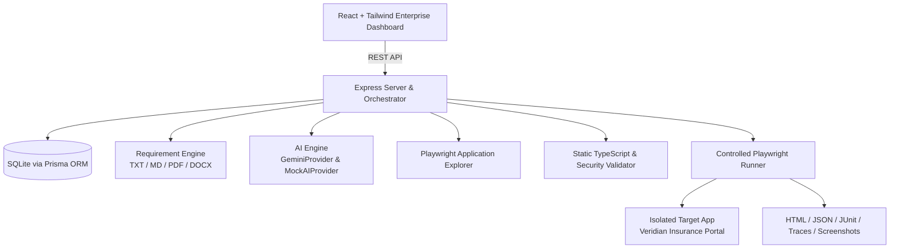
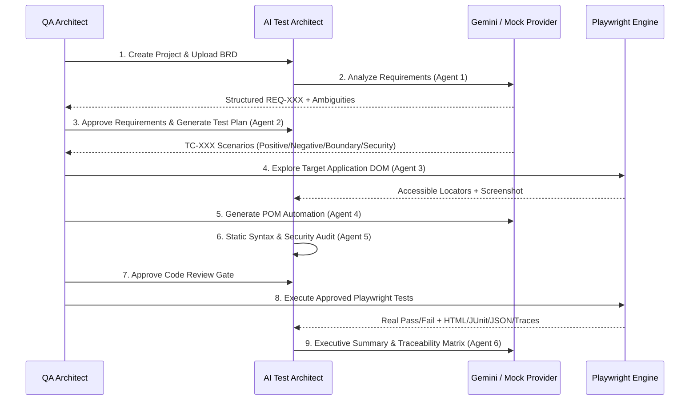

# AI Test Architect

**AI-Powered Requirement-to-Playwright Automation Platform**


---

## 1. Project Overview

**AI Test Architect** is a full-stack Quality Engineering platform that automates the complete software testing lifecycle—from ingesting Business Requirement Documents (BRDs/PRDs) to generating reviewed Playwright TypeScript Page Object Models, executing real browser suites, producing executive QA summaries, and maintaining a live Requirement Traceability Matrix.

Unlike simple prompt-to-snippet chatbots, every AI output is schema-validated with Zod, verified by a static TypeScript validation agent, gated by human code review, and executed against a real browser via Playwright Test.

## 2. Business Problem

Engineering teams struggle with disconnected QA artifacts: requirements live in Markdown/PDF/DOCX specs, test cases live in spreadsheets, Playwright selectors drift from live DOMs, and leadership lacks real-time visibility into which business rules are actually verified by passing automated tests.

## 3. Key Capabilities

- **Multi-Format Requirement Ingestion**: Paste text or upload `.txt`, `.md`, `.pdf`, and `.docx` specifications with size and type validation.
- **Agentic Requirement Analysis**: Extracts sequential `REQ-XXX` items, acceptance criteria, business rules, actors, ambiguities, missing information, and assumptions.
- **Risk-Based Test Planning**: Generates Positive, Negative, Boundary, Validation, Authorization, and Security test scenarios (`TC-XXX`), editable and filterable prior to approval.
- **Playwright Application Explorer**: Inspects target URLs in headless Chromium, discovers resilient `getByTestId`, `getByRole`, and `getByLabel` locators, and captures full-page screenshots.
- **POM Code Generation & Static Validation**: Produces modular `pages/`, `fixtures/`, `test-data/`, and `tests/*.spec.ts` files checked by the TypeScript compiler and security scanner.
- **Human Code Review Gate**: Enforces explicit approval before any generated code can execute.
- **Real Playwright Execution & Artifacts**: Runs approved tests on Chromium, Firefox, or WebKit and collects HTML reports, JSON results, JUnit XML, traces, screenshots, and videos.
- **Requirement Traceability Matrix & Executive Summary**: Links `REQ -> AC/BR -> TC -> Spec -> Execution Result` with CSV/JSON export and AI root-cause reporting.
- **Isolated Demo Insurance Target App**: Includes *Veridian P&C Insurance* (Customer, Adjuster, and Admin portals) for realistic enterprise workflow testing.

## 4. Architecture Diagram



## 5. End-to-End Workflow



## 6. AI Agent Responsibilities

| Agent | Module | Responsibility |
| --- | --- | --- |
| **Agent 1: Requirement Analyst** | `packages/ai-engine` | Extracts `REQ-XXX`, acceptance criteria, business rules, ambiguities, and missing info. |
| **Agent 2: Test Planning Agent** | `packages/ai-engine` | Converts requirements into risk-based `TC-XXX` scenarios validated via Zod. |
| **Agent 3: Application Explorer** | `packages/application-explorer` | Inspects live target DOMs safely and extracts semantic Playwright locators. |
| **Agent 4: Playwright Code Generator** | `packages/ai-engine` | Generates POM classes, fixtures, JSON test data, and `.spec.ts` files. |
| **Agent 5: Test Validation Agent** | `packages/test-generator` | Runs TypeScript syntax checks, security scans, and assertion/mapping checks. |
| **Agent 6: Coverage & Executive Analyst** | `packages/coverage-engine`, `packages/reporting` | Computes requirement coverage, builds traceability matrix, summarizes run artifacts. |

## 7. Technology Stack

- **Frontend**: React 19, TypeScript, Tailwind CSS v4, Lucide Icons
- **Backend**: Node.js 22, Express, TypeScript, Zod v4, Prisma ORM, SQLite
- **Automation**: Playwright Test, Page Object Model, Fixtures, HTML/JSON/JUnit reporters
- **AI**: Official `@google/genai` SDK (`gemini-4-hydrogen` default) + `MockAIProvider`
- **Testing & CI**: Vitest, Playwright E2E, GitHub Actions

## 8. Project Structure

```text
ai-test-architect/
├── apps/
│   ├── web/api/                 # Platform REST API routes
│   └── demo-insurance-app/      # Isolated Veridian Insurance backend
├── packages/
│   ├── ai-engine/               # Providers, prompts, Zod schemas, orchestrator
│   ├── application-explorer/    # Playwright DOM explorer
│   ├── coverage-engine/         # Coverage audit & CSV/JSON traceability
│   ├── db/                      # Prisma client singleton
│   ├── playwright-runner/       # Controlled Playwright test execution
│   ├── reporting/               # Executive QA summary builder
│   ├── requirement-engine/      # TXT/MD/PDF/DOCX ingestion
│   ├── security/                # SSRF URL guard & path traversal protection
│   └── test-generator/          # Workspace writer & Agent 5 static validator
├── prisma/schema.prisma         # 14 relational SQLite models
├── sample-requirements/         # Sample Insurance BRDs
├── src/                         # Platform React UI + isolated Demo Insurance UI
├── tests/                       # Unit, integration, and E2E suites
├── docs/                        # Architecture, workflow, security, setup guides
└── .github/workflows/ci.yml     # CI pipeline
```

## 9. Installation & Setup

```bash
npm install
npx prisma generate
npx prisma db push
npx playwright install chromium
```

## 10. Environment Configuration

Copy `.env.example` to `.env`:

```env
GEMINI_API_KEY="MY_GEMINI_API_KEY"
GEMINI_MODEL="gemini-4-hydrogen"
AI_PROVIDER="auto"
DATABASE_URL="file:./dev.db"
APP_URL="http://localhost:3000"
ALLOWED_TARGET_ORIGINS="http://localhost:3000,http://127.0.0.1:3000"
```

## 11. Running Locally

### Offline Demo Mode (No Gemini Key Required)
```bash
AI_PROVIDER=mock npm run dev
```
- Platform UI: `http://localhost:3000`
- Demo Insurance App: `http://localhost:3000/demo-insurance`

### With Google Gemini
```bash
GEMINI_API_KEY="your-key" AI_PROVIDER=gemini npm run dev
```

## 12. Sample Demo Workflow

1. Open `http://localhost:3000` and click **Load Veridian Insurance Demo**.
2. Click **Analyze Requirements** to extract `REQ-001`..`REQ-004`, business rules, and ambiguities, then click **Approve All Requirements**.
3. Open **Test Plans**, click **Generate Test Plan**, inspect/edit scenarios, and click **Approve All Scenarios**.
4. Open **Automation**, click **Explore Application** to inspect the Veridian Insurance Portal DOM and capture a screenshot.
5. Click **Generate Automation**, review the generated `pages/`, `fixtures/`, `test-data/`, and `tests/*.spec.ts` files, then approve in **Code Review Gate**.
6. Open **Execution** and click **Execute Approved Playwright Tests**.
7. Open **Reports** to review real pass/fail metrics, HTML/JUnit/JSON report links, AI Executive Summary, and export the **Requirement Traceability Matrix** (CSV/JSON).

## 13. Running Platform Tests

```bash
npm run lint              # TypeScript strict check
npm run test:unit         # Vitest unit tests
npm run test:integration  # API + real Playwright pipeline integration tests
npm run test:e2e          # End-to-end UI workflow (start server first)
```

## 14. Security Guardrails & Known Limitations

- See [`docs/security.md`](docs/security.md) for SSRF protections, untrusted-input isolation, static AST blocking, code review gating, and local child-process isolation boundaries.
- Multi-tenant production deployments should execute generated Playwright suites inside ephemeral rootless containers rather than host-level child processes.

## 15. Future Enhancements

- Visual regression diffing across baseline and candidate screenshots.
- Containerized ephemeral Playwright worker pool for parallel multi-project runs.
- Direct GitHub PR export for generated Page Object suites.
